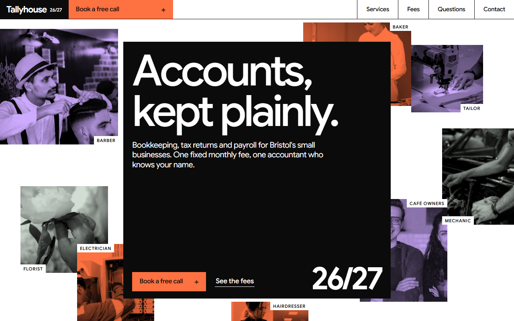
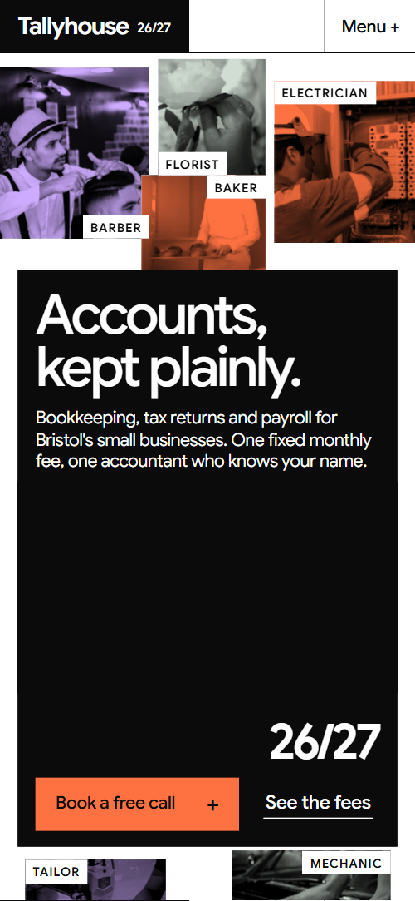
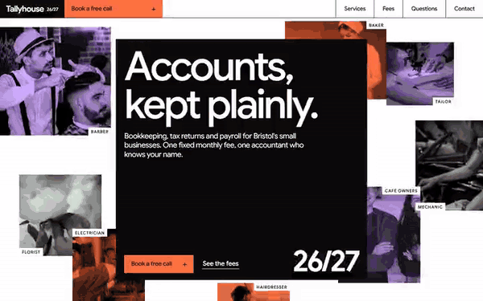

# Free HTML accountant website template with GSAP scroll animations — Tallyhouse

**Website for a small accountancy practice that does bookkeeping, tax returns and payroll: a free HTML template in one file, with GSAP scroll animations, no build step, MIT license. Made by [8B](https://8b.com/), the AI website builder.**

[](LICENSE)  

**[Live demo](https://8bsite.github.io/accountant-website-template/)** · **[Use this template](https://github.com/new?template_name=accountant-website-template&template_owner=8bsite)** · **[Download ZIP](https://github.com/8bsite/accountant-website-template/archive/refs/heads/main.zip)** · **[Template page on 8b.com](https://8b.com/templates/tallyhouse/)**

<a href="https://8bsite.github.io/accountant-website-template/"></a> <a href="https://8bsite.github.io/accountant-website-template/"></a>

<p align="center"><a href="https://8bsite.github.io/accountant-website-template/"></a><br><sub>Scroll animation</sub></p>

A one-page site for a local accountancy firm that serves sole traders and small businesses, with a sample monthly report, services, a tax-year calendar, client stories, team and fixed fees. Flat orange, lavender and sage blocks, hairlines and huge tight type, like an annual report; as you scroll, a black cover spreads over a collage of tinted photos, a dot screen resolves into each service photo, the tax year slides past a line that ticks off each deadline, and the fee blocks rise to their prices.

Good for: accountant or bookkeeper; tax adviser or payroll bureau; small professional practice with fixed monthly plans; any service business that sends clients a regular report.

## Use it with an AI coding agent

Download the files into your project (in Windows PowerShell type `curl.exe`):

```bash
curl -LO https://raw.githubusercontent.com/8bsite/accountant-website-template/main/index.html
curl -LO https://raw.githubusercontent.com/8bsite/accountant-website-template/main/AGENTS.md
curl -LO https://raw.githubusercontent.com/8bsite/accountant-website-template/main/LICENSE
curl -LO https://raw.githubusercontent.com/8bsite/accountant-website-template/main/CREDITS.md
```

Then give your agent this prompt:

```text
Read AGENTS.md, then edit index.html. Use this template as the base for a site for <your practice: what you do (bookkeeping, tax, payroll…), for whom, where, your plans and prices, how to book a call>. Keep the layout, the motion and the single-file format; replace the brand name, copy, the sample report, the deadlines for your country, client stories, team, photos, prices, links and contacts, and recolour it through the CSS variables if needed.
```

Give the agent the downloaded file, not a link: from a link it would rebuild a different page. No agent? Click **[Use this template](https://github.com/new?template_name=accountant-website-template&template_owner=8bsite)**, edit `index.html` and turn on **Settings → Pages**.

## What's on the page

- **Navigation** — top bar: wordmark with the year, section links, Book a free call button; phone menu overlay
- **Accounts, kept plainly.** — first screen: a black cover square with headline and two buttons over a collage of eight tinted photos with captions (demo: the trades of the clients), then a black statement screen
- **Your month, on one page.** — sample one-page report beside four numbered notes (demo: a bakery's September)
- **Three jobs, done every month whether you remember or not.** — three full-width colour slabs, one per service, each with a big name, included list, button and a tinted photo
- **Switching takes one phone call.** — how to switch: a large photo, a heading with a highlight and three numbered steps
- **The tax year, handled before it's due.** — pinned horizontal track of twelve months with colour-coded deadline chips (demo: UK tax year April to March)
- **Three kinds of year, kept.** — three client quotes as split blocks: dark panel with portrait and name, colour panel with the quote
- **Four accountants. You will know one of them well.** — team of four: portraits, names and what each looks after
- **Questions people ask before they switch.** — questions and answers on a sage ground (native &lt;details&gt;)
- **Fixed monthly fees. The height of each block is its price.** — three fixed monthly plans as colour blocks whose heights follow their prices
- **Book a free twenty minutes.** — office, phone, email and hours, plus a booking form in a black panel (placeholders)
- **Footer** — black footer: address and contacts, links, a giant year and a width-filling wordmark, copyright and the Design: 8B credit

## Design

Palette:         
Fonts: Google Sans (Google Fonts). Change both through the CSS variables in the `:root` block at the top of `<head>`. A big display line with `style="--len:N"` fills its width: set N to its new number of characters.

- The bar chart in the sample report and the fee blocks read their numbers from <data value="…"> elements: when you change a figure, change the value too and the heights follow.
- The colour tint and the dot screen on the photos are CSS over ordinary photos, so a new photo takes the slab colours on its own; the three slab colours are --color-3, --color-4 and --color-5 in :root.

## Before you publish

- Replace everything marked `data-8b-placeholder` (social preview image, favicon, phone, email, form) and the invented demo facts: prices, dates, address. [AGENTS.md](AGENTS.md) lists them.
- The form sends nothing yet: connect it to Formspree or Netlify Forms, or remove it.

## Tech

GSAP 3.13.0, ScrollTrigger, Lenis 1.3.27 from jsDelivr, 112 KB, no build step. Chrome and Edge 111+, Safari 16.2+, Firefox 113+ (it uses color-mix(), cascade layers, small/dynamic viewport units). With "reduce motion" on, the page is complete and still.

## License

MIT, see [LICENSE](LICENSE); the "Design: 8B" footer link is welcome, not required. Photos, fonts and libraries keep their own licences: [CREDITS.md](CREDITS.md). More free templates: [8b.com/templates](https://8b.com/templates/) · [github.com/8bsite](https://github.com/8bsite).
